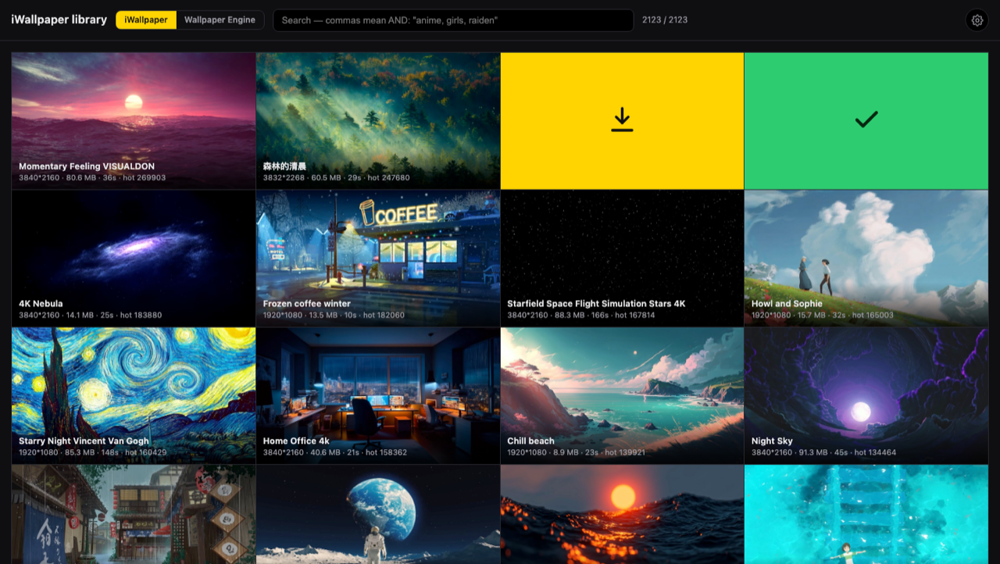
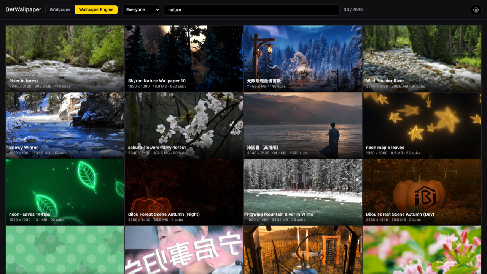
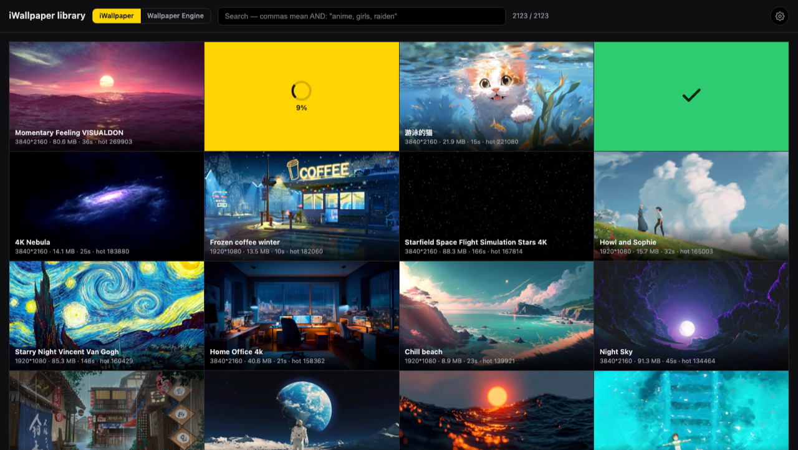
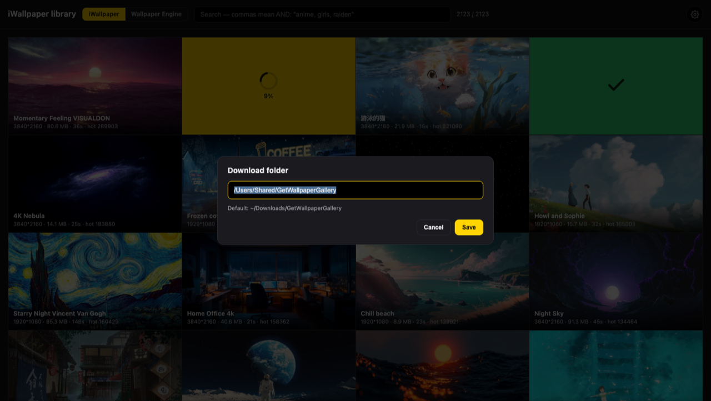

# GetWallpaper

A local web gallery to **browse and download live wallpapers** from two sources:

- **iWallpaper** — the Mac app's public CloudKit catalogue (2,123 videos)
- **Wallpaper Engine** — video wallpapers from the Steam Workshop (app `431960`)

It runs entirely on your machine: one Python process, a browser tab on
`127.0.0.1`, no accounts, no telemetry.



## Features

- 4-column thumbnail grid with hover-to-download tiles
- Download states: yellow (hover) → spinner with progress → green ✓; hover a
  downloaded tile to reveal it in Finder / Explorer / file manager
- Smart search: comma-separated terms are **AND**ed and matched against titles
  and Workshop tags — `anime, girls, raiden`
- Wallpaper Engine rating filter: Everyone (default), Questionable, Mature, All
- Infinite scroll through Workshop pages, plus a background fill that indexes the whole Workshop slice (up to Steam's 30,000-item cap)
- Configurable download folder; files are named after the wallpaper title
- Adjustable thumbnail cache limit per source (default 1 GiB, oldest-first eviction)
- Optional background prefill that fills the thumbnail cache automatically, with a progress bar in the header



## Install

### Option A — pip / pipx (recommended)

Download the `.whl` from the
[latest release](https://github.com/Winterrks/GetWallpaper/releases/latest) and:

```bash
pipx install ./getw-*.whl
# or: python3 -m pip install --user ./getw-*.whl
```

### Option B — no install (zipapp)

Download `getw.pyz` from the release and run it with Python 3.10+:

```bash
python3 getw.pyz start
```

### Option C — from source

```bash
git clone https://github.com/Winterrks/GetWallpaper.git
cd GetWallpaper
python3 -m getw start
```

## Quick start

```bash
getw setup     # pick a download folder, check SteamCMD (optional)
getw start     # opens http://127.0.0.1:8000
```

`getw setup` is optional — the app works immediately with the default folder at
`~/Downloads/GetWallpaperGallery/`.



### Settings

Click the ⚙ icon in the top-right corner:

- **Download folder** — created and write-checked before saving
- **Thumbnail cache limit (MB)** — per source; lowering it immediately evicts
  the oldest thumbnails
- **Prefill thumbnails** — warms the cache in the background until it reaches
  the limit (iWallpaper first, then the Workshop catalogue)

Settings are stored in `settings.json` in the app data directory.



## Wallpaper Engine setup

Browsing Workshop metadata and thumbnails needs **no login**. Downloading does —
Steam only serves Workshop files to accounts that own Wallpaper Engine.

1. Install SteamCMD:
   - macOS: `brew install steamcmd`
   - Linux: your distro package, or the
     [official instructions](https://developer.valvesoftware.com/wiki/SteamCMD)
   - Windows: [SteamCMD download](https://developer.valvesoftware.com/wiki/SteamCMD),
     add it to `PATH`
2. Log in once:

   ```bash
   getw login
   ```

   Steam Guard asks for a code the first time; the session is cached afterwards.
   The app auto-detects the cached account (`loginusers.vdf`) on each download.

Already have Workshop items downloaded by another tool? Point
`WE_WORKSHOP_DIR` at your `steamapps/workshop/content/431960` folder and the app
will copy from there instead.

**iWallpaper needs no login, account, or purchase** — its catalogue is public and
asset URLs are pre-signed.

## Platform support

| Feature | macOS | Linux | Windows |
|---|---|---|---|
| Browse, search, thumbnails, UI | ✅ | ✅ | ✅ |
| iWallpaper downloads + decrypt | ✅ `openssl` | ✅ `openssl` | ✅ `openssl` on PATH, or `pip install cryptography` |
| Wallpaper Engine downloads | ✅ SteamCMD + owned copy | ✅ | ✅ |
| Reveal file | Finder | xdg-open | Explorer |
| Steam account auto-detect | ✅ | ✅ | ✅ |

Pure Python 3.10+ (standard library only). State lives in:

- macOS: `~/Library/Application Support/GetWallpaper/`
- Windows: `%APPDATA%\GetWallpaper\`
- Linux: `~/.local/share/GetWallpaper/`

Override with `GETW_DATA_DIR`.

## CLI

```bash
getw start [--port 8000] [--no-browser]   # run the web UI
getw setup                                # download folder + environment checks
getw login [--account NAME]               # SteamCMD login for Workshop downloads
getw status                               # data dir, download folder, caches, Steam login
```

## Troubleshooting

| Symptom | Fix |
|---|---|
| Workshop download fails with `Not logged on` | `getw login` (needs an account that owns Wallpaper Engine) |
| Workshop download fails with `Download item … failed (Failure)` | The item was removed/private/region-locked, or another SteamCMD was running; retry once |
| iWallpaper download says decrypt failed | Install OpenSSL (Windows) or `pip install cryptography` |
| `Address already in use` | `getw start --port 8123` |
| A tile shows not-downloaded after you moved files | The app tracks files by absolute path; re-download or move files back |
| Workshop list looks stale | Delete `we_catalog*.json` in the data dir, or call `/api/we/records?refresh=1` |
| Thumbnails missing | They re-fetch on view; caches are capped at 1 GiB per source |

## Environment variables

| Variable | Purpose |
|---|---|
| `GETW_DATA_DIR` | Override the state directory (settings, indexes, caches) |
| `WE_STEAM_ACCOUNT` | Steam account name for SteamCMD (default: auto-detected) |
| `WE_WORKSHOP_DIR` | Existing `steamapps/workshop/content/431960` folder to copy from |
| `GETW_FETCH_WORKERS` | Parallel Workshop page fetches during fill (default 10, max 16) |
| `GETW_THUMB_WIDTH` | Workshop thumbnail width in pixels (default 400) |

## How it works

| Source | Catalogue | Thumbnails | Video |
|---|---|---|---|
| iWallpaper | bundled census metadata (`getw/wallpaper_census.json`) | CloudKit asset URLs | AES-128-ECB asset, decrypted locally |
| Wallpaper Engine | public Workshop browse pages, parsed from embedded JSON | Steam image CDN (`preview_url`, downscaled) | `steamcmd workshop_download_item 431960 <id>` |

Endpoints: `/`, `/api/records`, `/thumb/<uuid>`, `/download/<uuid>`,
`/reveal/<uuid>`, `/progress/iw/<uuid>`, `/api/we/records`,
`/we/thumb/<id>`, `/we/download/<id>`, `/we/reveal/<id>`, `/progress/we/<id>`,
`/api/settings` (GET/POST), `/health`.

## Building from source

```bash
python3 -m venv .venv && . .venv/bin/activate
pip install build
python -m build --outdir dist        # wheel + sdist
```

## License

MIT — see [LICENSE](LICENSE).

## Notes

- Downloads are for personal use. Workshop items belong to their authors and
  iWallpaper content is third-party; do not redistribute.
- The Wallpaper Engine source is unofficial and depends on Steam's public
  Workshop page markup; it may need updating if Steam changes it.
- Scene-type Wallpaper Engine wallpapers are excluded — they are packed `.pkg`
  projects, not plain video files.
